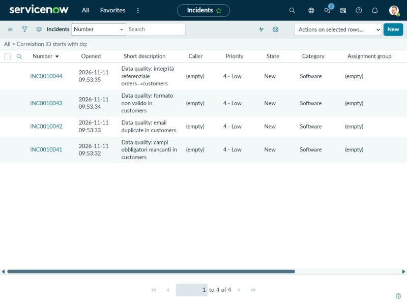
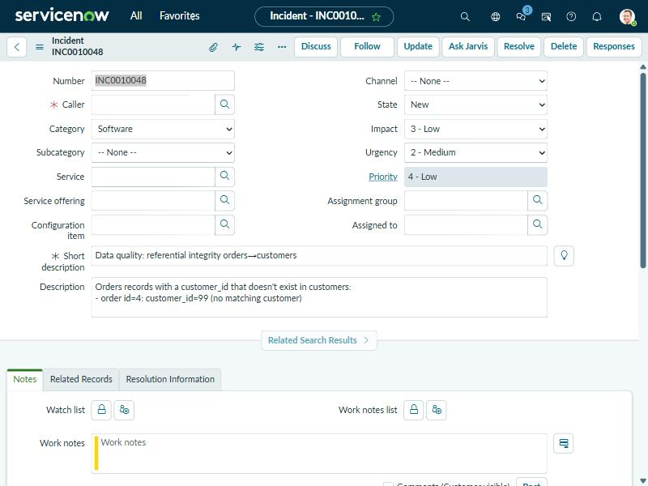

# Demo: MCP agent for data quality (DB → ServiceNow)

Demonstrates how an agent (Claude) can use two MCP servers — one for a
SQLite database, one custom for ServiceNow — to detect data quality issues
and automatically open tickets, with no orchestration code of its own: the
intelligence lives in the agent, the MCP servers are just "hands and eyes".

## Setup

1. Create the demo database (intentionally "dirty" data):

   ```bash
   python data/seed_db.py
   ```

2. Configure the ServiceNow credentials (PID instance):

   ```bash
   cp .env.example .env
   # then edit .env with the real SNOW_INSTANCE_URL, SNOW_USER, SNOW_PASSWORD
   ```

3. Install the ServiceNow server's dependencies:

   ```bash
   pip install mcp httpx python-dotenv
   ```

   The SQLite server (`mcp-server-sqlite`) runs on the fly via `uvx` (needs
   [uv](https://docs.astral.sh/uv/) installed), no manual install needed.
   `.mcp.json` launches it with `--with "mcp<2"` because the package is not
   compatible with the `mcp` 2.x SDK (the `FastMCP` API was removed).

   On Windows, if `pip install uv` doesn't put `uvx` on PATH, use the
   absolute path to `uvx.exe` (e.g. `...\Python\Python312\Scripts\uvx.exe`)
   as the `command` in `.mcp.json` instead of `"uvx"`.

4. Open this folder in Claude Code (or Claude Desktop): the two MCP servers
   in `.mcp.json` load automatically.

## Demo

Ask the agent, for example:

> Analyze the data quality in the database and open the necessary
> ServiceNow tickets, avoiding duplicates.

The agent:
1. queries `customers`/`orders` via the `sqlite` tool for the 4 checks
   described in [CLAUDE.md](CLAUDE.md) (completeness, duplicates,
   format/validity, referential integrity);
2. for each anomaly found, calls `search_incidents` on the `servicenow`
   server to verify that a ticket with the same `correlation_id` doesn't
   already exist;
3. if it doesn't, calls `create_incident` to open it.

Running the same prompt a second time, the agent should not create
duplicate tickets (thanks to the `search_incidents` + `correlation_id`
check) — a good way to demonstrate the flow's idempotency.

## Result

The 4 tickets opened automatically by the agent, one per anomaly category:



Detail of one incident, with the description generated by the agent:



## Structure

- `data/seed_db.py` — generates `data/crm.db` with dirty data.
- `mcp-servicenow/server.py` — custom MCP server for the ServiceNow Table
  API (`search_incidents`, `create_incident`).
- `.mcp.json` — registers the two MCP servers (`sqlite`, `servicenow`).
- `CLAUDE.md` — the data quality rules the agent applies.
